# Informe del taller EduConnect API Gateway

**Universidad de las Américas**  
Facultad de Ingeniería y Ciencias Aplicadas  
Asignatura: Integración de Sistemas  
Grupo 3: Jhoel Suarez, Mauricio Mora, Stefan Jativa y Justin Gomezcoello  
Fecha de ejecución: 24 de noviembre de 2026

## Contenido

1. Objetivo, justificación y alcance
2. Preparación del entorno
3. Arquitectura y conceptos utilizados
4. Instalación y ejecución en Docker
5. Construcción y uso de la colección Postman
6. Reto 0: despliegue de Kong
7. Reto 1: punto de acceso único
8. Reto 2: autenticación con API Key
9. Reto 3: control de consumo
10. Reto 4: respuestas negativas y backend no disponible
11. Desafío de transferencia: Certificados
12. Resultados, conclusiones y recomendaciones
13. Uso de IA y fuentes

## 1. Objetivo, justificación y alcance

El objetivo fue desplegar Kong Gateway con Docker Compose y comprobar que cuatro APIs simuladas pueden exponerse mediante una sola dirección. También se configuró una API Key para identificar consumidores y políticas de rate limiting para controlar solicitudes. La prueba permite observar cómo un gateway desacopla al cliente de las direcciones internas de los backends y centraliza controles básicos.

EduConnect necesita evitar que cada consumidor mantenga conexiones y políticas distintas para cada API. Se decidió implementar una PoC local, acotada a integración y tráfico HTTP, sin cambiar los sistemas existentes. Se usaron datos ficticios y estáticos. El alcance no incluye identidad de usuarios finales, permisos de negocio, persistencia, alta disponibilidad ni monitoreo distribuido completo.

## 2. Preparación del entorno

Se utilizó Docker Desktop para ejecutar los contenedores, Postman para construir y enviar solicitudes, y archivos declarativos versionados para repetir la configuración. Docker Compose define cinco contenedores: Kong y los mocks de Estudiantes, Matrículas, Pagos y Certificados. No es necesario instalar una base de datos.

Los archivos principales son `docker-compose.yml`, `kong/kong.yml`, `mocks/server.js` y `mocks/Dockerfile`. El repositorio también incluye la colección Postman, esta guía, una matriz de evidencias y scripts de verificación.

## 3. Arquitectura y conceptos utilizados

El flujo empieza en el cliente. Postman envía `GET http://localhost:8000/api/pagos` con la cabecera `apikey`. Kong reconoce la Route pública, valida el Consumer, aplica el límite y busca el Service de Pagos. Después reenvía a `http://pagos:3003/pagos` por la red interna `educonnect-net`. El mock devuelve JSON e identifica el servicio mediante `X-Service` y el campo `servicio`.

Un **Service** describe el destino interno, con nombre DNS, puerto y ruta del backend. Una **Route** describe qué solicitudes públicas (ruta y método) se dirigen a ese Service. Si cambia la dirección interna, se actualiza el Service; el consumidor puede conservar la URL pública. `strip_path: true` elimina el prefijo `/api` antes de reenviar al backend.

Un **Consumer** representa una aplicación cliente identificada por Kong. Un **plugin** aplica una política en el gateway. El modo **DB-less** carga los Consumers, Services, Routes y plugins desde `kong/kong.yml`, sin base de datos ni administración dinámica persistente. Docker Compose crea una red privada y resuelve los nombres de servicio; por eso la configuración no depende de IP internas rígidas.

| Componente | Nombre y puerto | Operación o función |
|---|---|---|
| Cliente | Postman | Envía solicitudes a la dirección pública |
| Kong | Proxy `localhost:8000` | Enrutamiento, API Key y rate limiting |
| Estudiantes | `estudiantes:3001` | `GET /estudiantes` |
| Matrículas | `matriculas:3002` | `GET /matriculas` |
| Pagos | `pagos:3003` | `GET /pagos` |
| Certificados | `certificados:3004` | `GET /certificados` |
| Red Docker | `educonnect-net` | Resolución DNS y tráfico interno |

## 4. Instalación y ejecución en Docker

Primero se abre una terminal en la carpeta del repositorio. El comando siguiente construye los mocks, crea la red y arranca todos los servicios:

```powershell
docker compose up -d --build
```

Después se consulta el estado:

```powershell
docker compose ps
```

El resultado correcto muestra Kong y los cuatro mocks en ejecución y saludables. En la sesión documentada, Docker Desktop mostró el stack `educonnect-gateway` expandido con los cinco contenedores activos. El proxy se publica en `8000`. La Admin API usa `127.0.0.1:8001`, limitada al loopback del equipo. Los puertos internos de los mocks no se publican en el host.

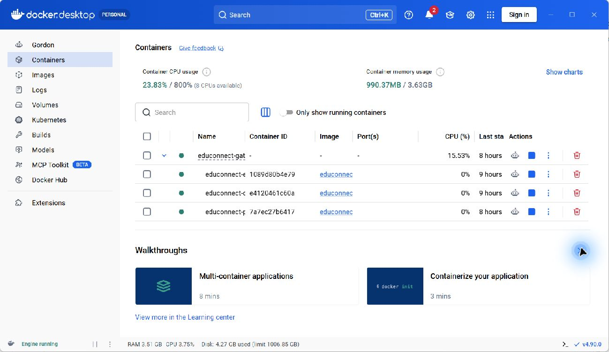

**Figura 1.** Vista real de Docker Desktop: stack expandido y contenedores de EduConnect en ejecución.

## 5. Construcción y uso de la colección Postman

En Postman se organizó la colección **EduConnect API Gateway - Grupo 3** con solicitudes positivas y negativas agrupadas por objetivo. Cada solicitud usa el método `GET`. En las solicitudes protegidas, la cabecera `apikey` recibe el valor de una variable de colección. Así se conserva una misma dirección base y se puede cambiar la clave según el Consumer que se quiere probar.

| Variable | Valor ficticio | Propósito |
|---|---|---|
| `baseUrl` | `http://localhost:8000` | Punto común de entrada |
| `apiKey` | `educonnect-poc-key-2026` | Pruebas generales positivas |
| `rateKey` | `educonnect-rate-key-2026` | Consumer dedicado al límite 5/min |
| `certKey` | `educonnect-cert-key-2026` | Consumer de Certificados, 2/min |

Para enviar una solicitud se selecciona en la colección y se pulsa **Send**. Postman presenta el estado HTTP en la parte superior del panel de respuesta y el cuerpo JSON debajo. El campo `servicio` y la cabecera `X-Service` permiten comprobar qué mock atendió la ruta. En la evidencia también se documentó dentro de Postman el propósito, método, URL, cabecera y resultado esperado de la solicitud de Estudiantes.

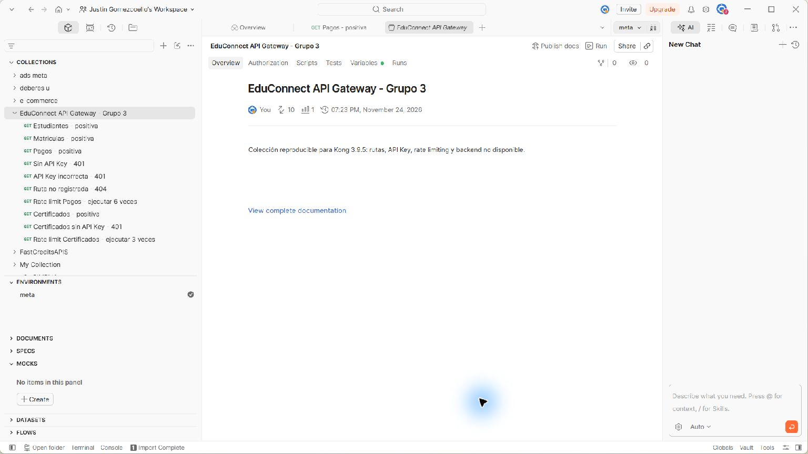

**Figura 2.** Colección y solicitudes visibles en la aplicación Postman local.

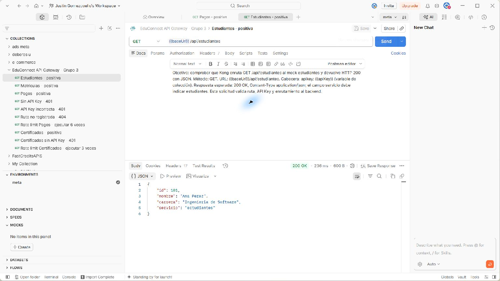

**Figura 3.** Detalle de la solicitud de Estudiantes con su explicación y respuesta ejecutada.

Las claves son credenciales deliberadamente ficticias de laboratorio. No se utilizan credenciales personales. La cabecera `apikey` se valida en Kong; `hide_credentials: true` impide que el secreto de prueba pase al mock.

## 6. Reto 0: despliegue de Kong

**Predicción.** Si Kong y los backends están en una red de Docker Compose y las URLs internas usan nombres de servicio, Kong podrá resolver los mocks sin direcciones IP fijas.

**Decisión.** Se fijó Kong Gateway `3.9.5` y se activó el modo DB-less. La configuración declarativa define cuatro Consumers ficticios, cuatro Services, cuatro Routes y los plugins.

**Prueba.** Se levantó el stack con `docker compose up -d --build` y se revisó con `docker compose ps` y Docker Desktop.

**Resultado.** Kong y los cuatro mocks quedaron activos. La solicitud positiva a cada backend confirmó que el proxy puede enrutar a sus nombres DNS internos.

**Limitación.** Esta observación demuestra la integración dentro de una red local. No prueba failover entre hosts, balanceo entre réplicas ni alta disponibilidad productiva.

## 7. Reto 1: punto de acceso único

**Predicción.** Las rutas públicas `/api/estudiantes`, `/api/matriculas` y `/api/pagos` deben llegar al mock correspondiente y devolver `200 OK` con JSON. El desafío de transferencia agrega `/api/certificados`.

**Decisión.** Se definió una Route por recurso y un Service por backend. Las cuatro rutas admiten `GET` y aplican la política de autenticación.

**Pruebas y resultados.** Desde Postman se enviaron solicitudes con la API Key general. Cada respuesta devolvió `200 OK` y un cuerpo JSON con el identificador y el nombre del servicio.

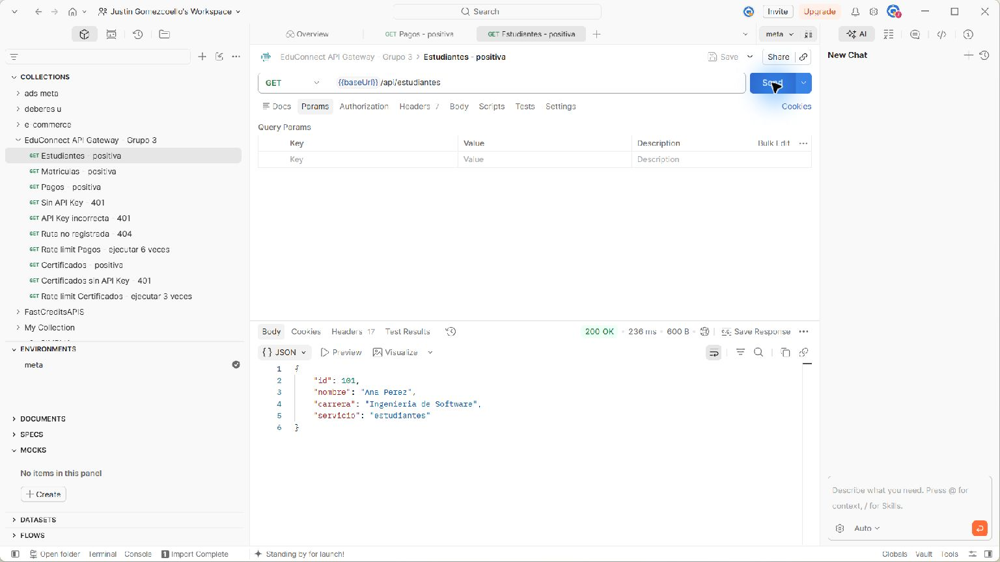

**Figura 4.** Estudiantes: `200 OK`; el JSON identifica el servicio `estudiantes`.

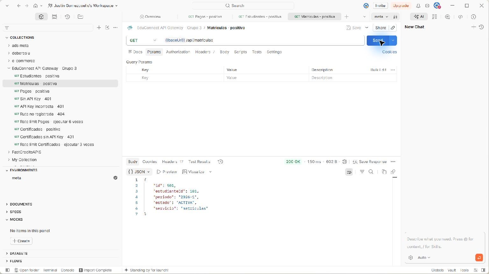

**Figura 5.** Matrículas: `200 OK`; el JSON identifica el servicio `matriculas`.

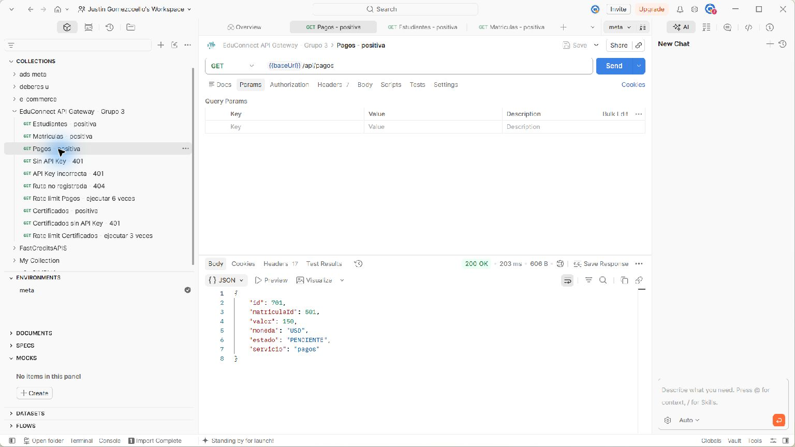

**Figura 6.** Pagos: `200 OK`; el JSON identifica el servicio `pagos`.

**Interpretación.** El cliente solo necesita conocer `localhost:8000` y las rutas públicas. Si cambia un nombre o puerto interno, se actualiza el `url` del Service correspondiente; si cambia la URL pública, se actualiza la Route.

## 8. Reto 2: autenticación con API Key

**Predicción.** La ausencia de clave o una clave que no corresponda a un Consumer registrado provocará `401 Unauthorized`. Una clave válida permitirá que una solicitud a una ruta existente continúe.

**Decisión.** El plugin `key-auth` busca la cabecera `apikey`. Se configuró `educonnect-app` para pruebas generales y dos Consumers dedicados a las pruebas de consumo. Las claves son ficticias.

**Pruebas.** En Postman se envió `GET /api/estudiantes` sin la cabecera y se observó `401 Unauthorized`, con el mensaje `No API key found in request`. La suite envió también una clave incorrecta y registró `401`; con la clave válida registró `200`.

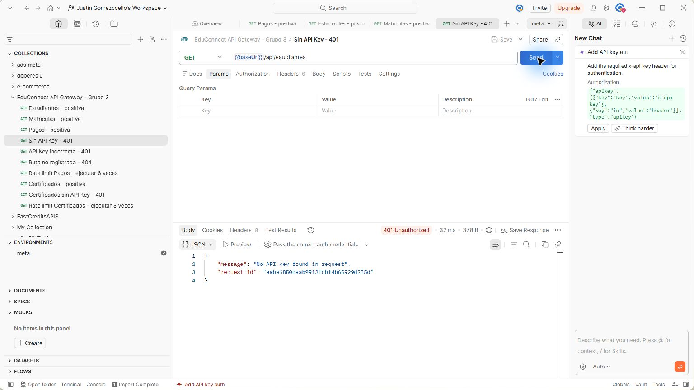

**Figura 7.** Postman muestra `401 Unauthorized` para la solicitud sin `apikey`.

**AuthN y AuthZ.** La autenticación (AuthN) identifica quién presenta la credencial. La autorización (AuthZ) determina qué operaciones y recursos puede usar esa identidad. Una API Key válida identifica al Consumer, pero no demuestra que un usuario tenga permiso para consultar una matrícula, un pago o un certificado específico.

## 9. Reto 3: control de consumo

**Predicción.** Dentro de una misma ventana, un Consumer nuevo podrá efectuar cinco solicitudes y la sexta será rechazada con `429 Too Many Requests`.

**Decisión.** En las rutas originales se configuró `minute: 5`, `policy: local` y `limit_by: consumer`. El Consumer `educonnect-rate` separa esta prueba de las solicitudes generales.

**Prueba real.** `python scripts/verify.py` envió seis solicitudes seguidas a `GET /api/pagos` con `educonnect-rate-key-2026`. El JSON registra la hora y el estado de cada intento.

| Solicitud | Estado observado |
|---:|---:|
| 1 | 200 |
| 2 | 200 |
| 3 | 200 |
| 4 | 200 |
| 5 | 200 |
| 6 | 429 |

**Resultado.** La secuencia observada fue `[200, 200, 200, 200, 200, 429]`, acorde a la predicción. La ventana y los contadores son locales a la instancia de Kong. En una arquitectura con varias réplicas, cada instancia podría llevar un contador diferente. Para una cuota distribuida se recomienda un almacenamiento compartido como Redis y una política compatible.

## 10. Reto 4: respuestas negativas y backend no disponible

### Ruta no registrada

**Predicción.** Una solicitud que no coincida con ninguna Route debe devolver `404 Not Found`.

**Prueba.** Postman envió `GET {{baseUrl}}/api/desconocido` con una API Key válida.

**Resultado.** Kong respondió `404 Not Found` y el cuerpo indicó que no encontró una Route coincidente. El código no corresponde a una falla del mock: la URL pública no está configurada.

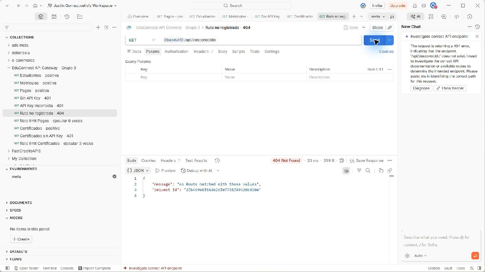

**Figura 8.** Respuesta real `404 Not Found` de Kong para una ruta no registrada.

### Backend de Pagos detenido y recuperación

**Predicción.** Si se detiene solo el mock de Pagos, una solicitud válida a la ruta de Pagos debe devolver un error de proxy. El número exacto depende del momento de la desconexión y del estado de DNS. Al recuperar el mock, la solicitud debería volver a ser atendida.

**Procedimiento.** Se detuvo el servicio de Pagos, se envió la solicitud desde Postman, se inició nuevamente Pagos y se esperó hasta que Docker Compose mostrara su healthcheck como `healthy`. En esta ejecución Kong conservó el error de resolución del nombre del backend durante el primer intento de recuperación, por lo que se reinició Kong. Una vez saludable, Postman volvió a enviar `GET /api/pagos`.

```powershell
docker compose stop pagos
# En Postman: GET {{baseUrl}}/api/pagos con apikey: {{apiKey}}
docker compose start pagos
docker compose ps
docker compose restart kong
docker compose ps
```

**Resultado observado.** Con el backend detenido Postman mostró `503 Service Temporarily Unavailable` y `name resolution failed`. Después del reinicio de Pagos y Kong, la solicitud volvió a mostrar `200 OK` y el JSON de Pagos. Se anotan ambos estados tal como ocurrieron; no se presupone un código único para todos los fallos de backend.

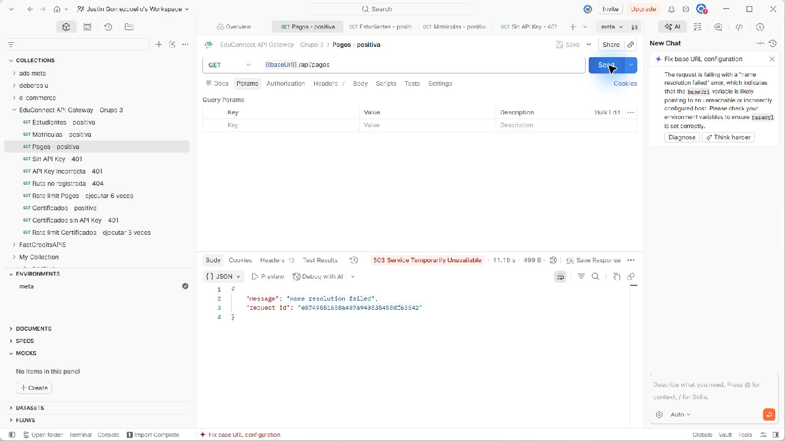

**Figura 9.** El backend de Pagos no estaba disponible; Kong devolvió `503` por resolución DNS.

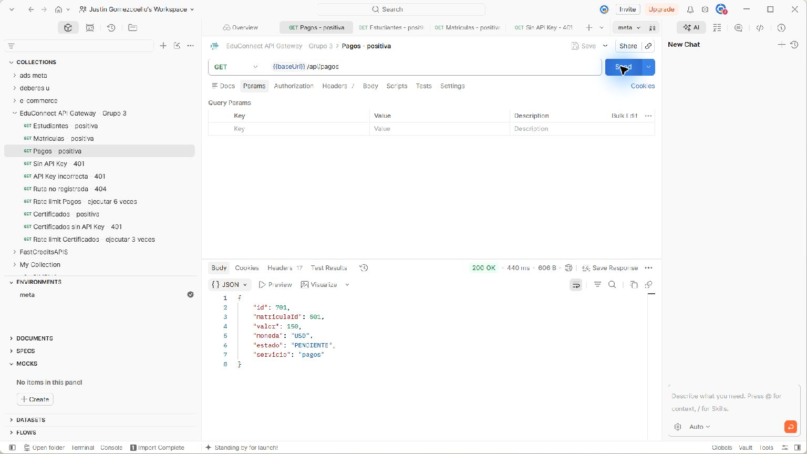

**Figura 10.** Después de recuperar Pagos y Kong, la misma ruta respondió `200 OK`.

## 11. Desafío de transferencia: Certificados

**Predicción.** Se puede incorporar un cuarto backend académico con una nueva Route pública, mantener la API Key y definir un límite distinto sin alterar las tres rutas originales.

**Decisión.** Se agregó el mock `certificados` en el puerto interno `3004`, el Service `certificados-service` y la Route `GET /api/certificados`. La ruta usa `key-auth` y rate limiting de `minute: 2`.

**Prueba positiva.** Postman envió la solicitud con una clave registrada. La respuesta fue `200 OK`, `X-Service: certificados` y un JSON con estado `EMITIDO`.

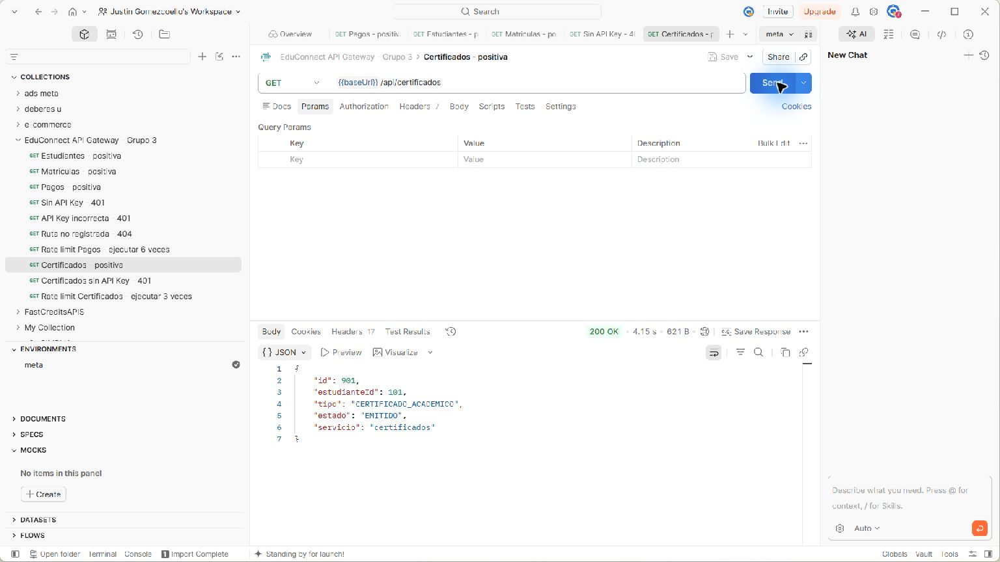

**Figura 11.** Certificados respondió `200 OK` a través de Kong.

**Pruebas de política.** Sin API Key la suite observó `401`. Con el Consumer dedicado `educonnect-cert`, la ráfaga de tres intentos dio `[200, 200, 429]`. El límite más estricto es propio de esa ruta; aún no constituye autorización de negocio para emitir o consultar certificados.

## 12. Resultados, conclusiones y recomendaciones

La suite final registró **11 casos aprobados de 11**: cuatro rutas positivas, credencial ausente, credencial inválida, ruta válida autenticada, ruta desconocida, Certificados positivo y sin clave, y ambas ráfagas de consumo. El caso independiente de backend no disponible quedó documentado con `503` durante la interrupción y `200` después de la recuperación.

La PoC reduce el acceso directo disperso y permite centralizar autenticación del Consumer, enrutamiento y límites básicos. Se comprobó la diferencia entre Service y Route, la resolución DNS de Compose, las respuestas `401`, `404` y `429`, y la ampliación para Certificados. El gateway no elimina la obligación de validar permisos de negocio dentro de cada servicio.

La principal ventaja de un gateway es aplicar políticas comunes y desacoplar a los clientes de los destinos internos. El principal riesgo es concentrar tráfico y controles en un componente crítico. La solución aún no verifica identidad final, autorización por matrícula o recurso, operación con réplicas, TLS, persistencia, métricas distribuidas ni recuperación automatizada.

Antes de producción se recomienda integrar OAuth2/OIDC, roles o atributos para autorización, secretos gestionados y rotación, TLS, rate limiting distribuido con almacenamiento compartido, múltiples réplicas, balanceador, métricas y trazas, alertas, auditoría y pruebas de carga y recuperación.

## 13. Uso de IA y fuentes

Se utilizó IA generativa como apoyo para organizar la documentación y preparar verificaciones. La configuración se contrastó en Docker Desktop, Kong y Postman, además de ejecutarse la suite local. Las fuentes técnicas consultadas fueron:

- [Kong Gateway](https://developer.konghq.com/gateway/) y [modo DB-less](https://developer.konghq.com/gateway/db-less-mode/).
- [Plugin Key Authentication](https://developer.konghq.com/plugins/key-auth/) y [Rate Limiting](https://developer.konghq.com/plugins/rate-limiting/).
- [Docker Compose](https://docs.docker.com/compose/) y [documentación de Postman](https://learning.postman.com/docs/).
- [OWASP API Security](https://owasp.org/API-Security/).

La matriz completa con predicciones, decisiones, pruebas, resultados, evidencias y limitaciones está en `evidencia/matriz-evidencias.md`. Los resultados detallados se conservan en `evidencia/resultados-pruebas.json` y `evidencia/backend-no-disponible.json`.
