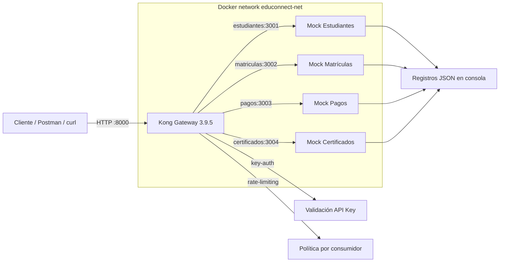

# Universidad de las Américas
## Facultad de Ingeniería y Ciencias Aplicadas

### Taller EduConnect API Gateway

**Grupo 3**

**Integrantes:** Jhoel Suarez, Mauricio Mora, Stefan Jativa y Justin Gomezcoello

**Fecha de ejecución:** 24 de noviembre de 2026  
**Repositorio:** https://github.com/justingomezcoello10/Taller-EduConnect-API-Gateway  
**Colección Postman:** https://altimetry-cosmonaut-59009318-s-team.postman.co/workspace/My-Workspace~40fd2367-f865-43cb-8c8d-7ec3357c2dcb/collection/41502927-459320f5-8ec7-4928-94dc-7f917980fd96

---

## 1. Contexto y misión

EduConnect presenta acceso directo a múltiples APIs, autenticación heterogénea, sobrecarga de consumidores externos y baja visibilidad operativa. Se implementó una prueba de concepto reproducible que expone cuatro servicios simulados mediante un único gateway. La PoC no implementa autorización de negocio, identidad final, observabilidad distribuida completa ni alta disponibilidad.

**Objetivo cumplido:** desplegar Kong en Docker Compose; integrar cuatro mocks independientes; aplicar API Key y rate limiting; probar rutas positivas y negativas; documentar decisiones y evidencias.

## 2. Arquitectura



### Flujo de una solicitud

1. El cliente envía `GET http://localhost:8000/api/estudiantes`.
2. Kong compara el prefijo público con una Route.
3. Se ejecuta el plugin Key Authentication.
4. Se aplica el contador de Rate Limiting.
5. Kong localiza el Service interno `estudiantes:3001` mediante DNS de Docker.
6. Kong elimina `/api` mediante `strip_path: true` y reenvía `/estudiantes`.
7. El mock devuelve JSON y registra la solicitud.

### Conceptos

- **Service:** destino interno: nombre, puerto y ruta del backend.
- **Route:** regla pública de coincidencia: método y URL.
- **Consumer:** identidad ficticia asociada a una API Key.
- **Plugin:** política aplicada en una ruta o Service.
- **Kong DB-less:** configuración declarativa cargada desde `kong.yml` sin base de datos.

## 3. Versión y contenedores

Se eligió **Kong Gateway 3.9.5** porque está disponible como imagen oficial, admite modo DB-less y puede fijarse de forma reproducible en Compose.

Evidencia real registrada:

```text
educonnect-certificados   Up ... (healthy)
educonnect-estudiantes    Up ... (healthy)
educonnect-kong           kong:3.9.5 ... (healthy)
educonnect-matriculas     Up ... (healthy)
educonnect-pagos          Up ... (healthy)
```

Puertos:

- Proxy público: `0.0.0.0:8000`
- Admin API local: `127.0.0.1:8001`
- Los mocks solo tienen puertos internos; no se publican al host.

## 4. Configuración de Kong

Archivo principal: `kong/kong.yml`.

```yaml
_format_version: "3.0"
_transform: true

consumers:
  - username: educonnect-app
    keyauth_credentials:
      - key: educonnect-poc-key-2026
  - username: educonnect-rate
    keyauth_credentials:
      - key: educonnect-rate-key-2026
  - username: educonnect-cert
    keyauth_credentials:
      - key: educonnect-cert-key-2026
```

Ejemplo de una ruta:

```yaml
services:
  - name: estudiantes-service
    url: http://estudiantes:3001/estudiantes
    routes:
      - name: estudiantes-route
        paths:
          - /api/estudiantes
        methods:
          - GET
        strip_path: true
        plugins:
          - name: key-auth
            config:
              key_names:
                - apikey
              hide_credentials: true
          - name: rate-limiting
            config:
              minute: 5
              policy: local
              limit_by: consumer
```

## 5. Consumidores y credenciales ficticias

| Consumidor | API Key | Uso |
|---|---|---|
| `educonnect-app` | `educonnect-poc-key-2026` | Pruebas generales |
| `educonnect-rate` | `educonnect-rate-key-2026` | Ráfaga de Pagos |
| `educonnect-cert` | `educonnect-cert-key-2026` | Ráfaga de Certificados |

Las claves son exclusivamente ficticias para el laboratorio y no representan secretos reales.

## 6. Mocks implementados

| Servicio | Puerto interno | Ruta interna | Identificador comprobable |
|---|---:|---|---|
| Estudiantes | 3001 | `/estudiantes` | `X-Service: estudiantes` |
| Matrículas | 3002 | `/matriculas` | `X-Service: matriculas` |
| Pagos | 3003 | `/pagos` | `X-Service: pagos` |
| Certificados | 3004 | `/certificados` | `X-Service: certificados` |

Cada mock responde `Content-Type: application/json`, registra solicitudes en consola y devuelve una cabecera `X-Service` que permite verificar cuál backend respondió.

## 7. Evidencias por reto

### Reto 0 — Kong y contenedores

**Hipótesis:** si Kong y los mocks usan la misma red Docker y nombres DNS, Kong podrá comunicarse sin IP rígidas.

**Decisión:** DB-less, Docker Compose y nombres `estudiantes`, `matriculas`, `pagos`, `certificados`.

**Prueba:**

```powershell
docker compose up -d --build
docker compose ps
docker compose logs -f kong
```

**Resultado:** los cinco contenedores quedaron operativos y saludables. Kong encontró a los mocks por DNS interno.

**Limitación:** no demuestra alta disponibilidad ni DNS distribuido entre múltiples hosts. Sí demuestra resolución dentro de una red Docker.

### Reto 1 — Punto de acceso único

**Hipótesis:** las rutas `/api/estudiantes`, `/api/matriculas`, `/api/pagos` y `/api/certificados` devolverán 200 con una API Key válida.

**Prueba real:**

```powershell
curl.exe -i -H "apikey: educonnect-poc-key-2026" http://localhost:8000/api/estudiantes
curl.exe -i -H "apikey: educonnect-poc-key-2026" http://localhost:8000/api/matriculas
curl.exe -i -H "apikey: educonnect-poc-key-2026" http://localhost:8000/api/pagos
curl.exe -i -H "apikey: educonnect-poc-key-2026" http://localhost:8000/api/certificados
```

**Resultado esperado observado: `HTTP 200` en las cuatro rutas.**

Ejemplo real de cabeceras:

```text
HTTP/1.1 200 OK
Content-Type: application/json; charset=utf-8
X-RateLimit-Limit-Minute: 5
X-RateLimit-Remaining-Minute: 3
Server: kong/3.9.5
X-Kong-Request-Id: 08af....
X-Service: pagos
X-Mock-Port: 3003
```

JSON real de pagos:

```json
{
  "id": 701,
  "matriculaId": 501,
  "valor": 150,
  "moneda": "USD",
  "estado": "PENDIENTE",
  "servicio": "pagos"
}
```

**Análisis:** cambiar solo una dirección interna requiere actualizar el `url` del Service; cambiar un nombre público requiere cambiar o añadir una Route. El cliente no conoce las IP internas.

### Reto 2 — API Key

**Hipótesis:** la ausencia o invalidez de la clave provocará 401; una clave válida permitirá acceso a una ruta existente.

**Prueba sin clave:**

```powershell
curl.exe -i http://localhost:8000/api/estudiantes
```

Respuesta observada:

```text
HTTP/1.1 401 Unauthorized
Content-Type: application/json; charset=utf-8
WWW-Authenticate: Key

{"message":"No API key found in request"}
```

**Prueba con clave incorrecta:**

```powershell
curl.exe -i -H "apikey: clave-invalida-de-prueba" http://localhost:8000/api/estudiantes
```

Resultado observado: `401 Unauthorized`.

**Prueba con clave válida:**

```powershell
curl.exe -i -H "apikey: educonnect-poc-key-2026" http://localhost:8000/api/estudiantes
```

Resultado observado: `200 OK`.

**Autenticación vs autorización:**

- AuthN: identifica y valida al consumidor mediante API Key.
- AuthZ: decide qué operación/recurso puede realizar.
- Una key válida no autoriza consultar cualquier matrícula o dato personal.
- Falta validar usuario final, roles, scopes, propiedad del recurso y políticas.

### Reto 3 — Rate limiting

**Hipótesis:** con el consumidor `educonnect-rate` se observarán cinco 200 y un 429 en la sexta solicitud dentro de la ventana.

**Configuración:**

```yaml
minute: 5
policy: local
limit_by: consumer
```

**Prueba:**

```powershell
1..6 | ForEach-Object {
  $status = curl.exe -s -o NUL -w "%{http_code}" `
    -H "apikey: educonnect-rate-key-2026" `
    http://localhost:8000/api/pagos
  Write-Host "$_ : HTTP $status"
}
```

**Resultado real final:**

```text
1 : HTTP 200
2 : HTTP 200
3 : HTTP 200
4 : HTTP 200
5 : HTTP 200
6 : HTTP 429
```

La sexta respuesta contiene una política de exceso.

**Ejemplo HTTP 429:**

```text
HTTP/1.1 429 Too Many Requests
Content-Type: application/json; charset=utf-8

{"message":"API rate limit exceeded"}
```

**Alcance:** por consumidor identificado por la API Key, en el contexto local de Kong y dentro de una ventana de minuto.

**Limitación:** varios procesos o instancias no compartirán el contador local. La arquitectura empresarial debería usar Redis o una política distribuida, con base compartida y sincronización.

### Reto 4 — Ruta inexistente y backend caído

**Hipótesis ruta:** una ruta no registrada devolverá 404.

**Prueba:**

```powershell
curl.exe -i -H "apikey: educonnect-poc-key-2026" http://localhost:8000/api/desconocido
```

Resultado observado: `404 Not Found`.

**Hipótesis backend:** detener el mock de Pagos dará 500/502/503/504, según el momento de conexión. La prueba no exige una cifra fija siempre que la causa y evidencia sean explicadas.

**Prueba:**

```powershell
docker compose stop pagos
curl.exe -i -H "apikey: educonnect-poc-key-2026" http://localhost:8000/api/pagos
docker compose start pagos
```

**Resultado observado:** al detener Pagos, Kong respondió HTTP 500 con `An unexpected error occurred`. Después de iniciar nuevamente el mock se observó inicialmente 503, y tras healthcheck saludable volvió a 200.

**Análisis:** el 500 representó una conexión fallida mientras el contenedor estaba detenido. El 503 posterior correspondió a la ventana de arranque/recuperación. Este tipo de código puede variar con DNS, healthchecks, worker, balanceador y configuración del proxy.

### Desafío de transferencia — Certificados

**Hipótesis:** el cuarto mock estará disponible vía `/api/certificados`, protegido por API Key y limitado a dos solicitudes por minuto para su consumidor.

**Cambios realizados:**

- Nuevo contenedor `certificados:3004`.
- Nuevo mock con ruta `/certificados`.
- Nuevo Service `certificados-service`.
- Nueva Route `/api/certificados`.
- Key Authentication.
- Rate Limiting con `minute: 2`.

**Prueba positiva:**

```powershell
curl.exe -i -H "apikey: educonnect-poc-key-2026" http://localhost:8000/api/certificados
```

Resultado: `200 OK`.

JSON real:

```json
{
  "id": 901,
  "estudianteId": 101,
  "tipo": "CERTIFICADO_ACADEMICO",
  "estado": "EMITIDO",
  "servicio": "certificados"
}
```

**Prueba sin key:** `401 Unauthorized`.

**Ráfaga dedicada:**

```text
1 : HTTP 200
2 : HTTP 200
3 : HTTP 429
```

**Limitación:** el límite es local y específico de la instancia de Kong; no se comparte entre réplicas. API Key general no representa autorización específica sobre emisión de certificados.

## 8. Suite automática final

Archivo ejecutado:

```powershell
python scripts/verify.py
```

Resultado final registrado:

```text
Casos aprobados: 11/11
Evidencia JSON: evidencia/resultados-pruebas.json
```

Casos incluidos:

1. Estudiantes 200.
2. Matrículas 200.
3. Pagos 200.
4. Sin API Key 401.
5. API Key incorrecta 401.
6. API Key válida 200.
7. Ruta desconocida 404.
8. Certificados con key 200.
9. Certificados sin key 401.
10. Ráfaga pagos 200×5 + 429.
11. Ráfaga certificados 200×2 + 429.

## 9. Evidencias de registros

Los mocks registran solicitudes como JSON:

```json
{
  "servicio": "pagos",
  "metodo": "GET",
  "ruta": "/pagos",
  "estado": 200,
  "cliente": "172.19.0.1",
  "consumidorKong": "educonnect-app",
  "apiKeyRecibidaEnBackend": false
}
```

Esto confirma que Kong reenvió la solicitud al backend correcto y que la API Key no llegó al mock; fue validada y eliminada por el gateway.

## 10. Decisiones arquitectónicas

### Ventajas

- Punto único de entrada.
- Políticas centrales para autenticación y consumo.
- Independencia entre cliente y dirección interna.
- Aislamiento de backends en una red privada.
- Configuración reproducible con Docker Compose.

### Riesgos

- El gateway se convierte en punto único de fallo.
- DB-less limita persistencia administrativa dinámica.
- El contador local no es distribuido.
- API Key sin cifrado/gestión puede ser robada.
- Los mocks no representan autorización ni datos reales.

### Mejoras productivas

- TLS obligatorio y secretos administrados.
- OAuth2/OIDC para identidad de usuario final.
- RBAC/ABAC o políticas por recurso.
- Redis compartido para rate limiting.
- Múltiples réplicas y balanceador externo.
- Circuit breaker, reintentos controlados y cache.
- Observabilidad: métricas, trazas y alertas.
- Auditoría, rotación de claves y pruebas de carga.

## 11. Respuestas a reflexiones finales

**¿Qué incidentes reduce esta PoC?** Reduce acceso directo disperso, diferentes políticas aisladas y falta de visibilidad básica.

**¿Qué permanece sin solución?** Alta disponibilidad, identidad final, autorización por recurso, datos persistentes, monitoreo integral y protección productiva de secretos.

**¿Por qué el gateway no autoriza?** AuthN identifica al consumidor; la autorización requiere atributos del usuario, acción, recurso y política de negocio.

**Ventaja principal:** centralización consistente de acceso y políticas.

**Riesgo principal:** concentración de seguridad, tráfico y disponibilidad en un componente crítico.

**Cambios antes de producción:** identidad estándar, RBAC/ABAC, Redis distribuido, múltiples instancias, TLS, secretos, trazabilidad y pruebas de carga.

## 12. Instrucciones reproducibles

```powershell
git clone https://github.com/justingomezcoello10/Taller-EduConnect-API-Gateway.git
cd Taller-EduConnect-API-Gateway
docker compose up -d --build
python scripts/verify.py
```

Detener:

```powershell
docker compose down
```

## 13. Referencias oficiales

- Kong Gateway: https://developer.konghq.com/gateway/
- Kong DB-less: https://developer.konghq.com/gateway/db-less-mode/
- Key Authentication: https://developer.konghq.com/plugins/key-auth/
- Rate Limiting: https://developer.konghq.com/plugins/rate-limiting/
- Docker Compose: https://docs.docker.com/compose/
- Postman: https://learning.postman.com/docs/
- OWASP API Security: https://owasp.org/API-Security/

## 14. Declaración de uso de IA y fuentes

El proyecto recibió apoyo de IA generativa para estructurar archivos, automatizar pruebas y redactar documentación. Las decisiones se contrastaron con ejecución real en Docker/Kong, registros observados y documentación oficial de Kong y Docker. Ninguna decisión quedó sustentada únicamente por una sugerencia de IA.
