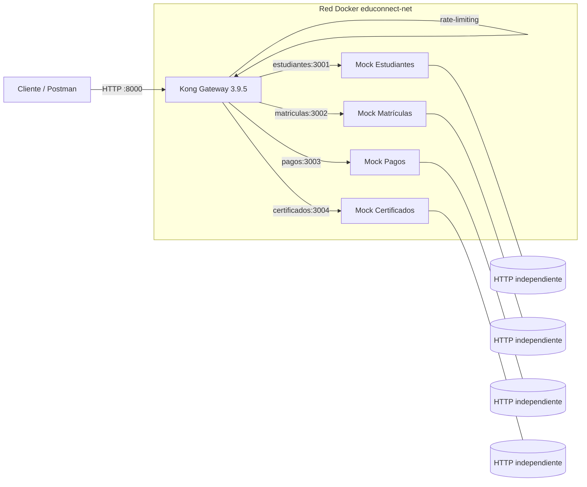

# Taller EduConnect — API Gateway

**Universidad de las Américas**  
**Facultad de Ingeniería y Ciencias Aplicadas**  
**Asignatura:** Taller EduConnect API Gateway  
**Grupo 3**  
**Integrantes:** Jhoel Suarez, Mauricio Mora, Stefan Jativa y Justin Gomezcoello

## Descripción

Prueba de concepto reproducible que expone cuatro APIs simuladas mediante un único punto de entrada administrado por **Kong Gateway 3.9.5**. La configuración usa el modo **DB-less** de Kong y red interna de Docker Compose.

## Arquitectura



- **Service:** destino interno al que Kong reenvía una solicitud.
- **Route:** coincidencia pública (`/api/...`) que activa un Service.
- **Consumer:** identidad ficticia asociada a una API Key.
- **key-auth:** valida la credencial en la cabecera `apikey`.
- **rate-limiting:** contador local por consumidor.

## Requisitos

- Docker Engine/Desktop
- Docker Compose v2
- `curl` o Postman
- Python 3.12+ (opcional para scripts de evidencia)

## Arranque

Desde la raíz del repositorio:

```powershell
docker compose up -d --build
docker compose ps
```

Gateway público: `http://localhost:8000`  
Admin API local: `http://127.0.0.1:8001`

## API Keys ficticias de laboratorio

| Consumidor | API Key | Uso |
|---|---|---|
| `educonnect-app` | `educonnect-poc-key-2026` | Pruebas generales |
| `educonnect-rate` | `educonnect-rate-key-2026` | Ráfaga de 5/min |
| `educonnect-cert` | `educonnect-cert-key-2026` | Ráfaga de certificados 2/min |

Estas credenciales son deliberadamente ficticias. No representan credenciales personales ni reales.

## Rutas disponibles

| Ruta pública | Respuesta esperada | Backend interno |
|---|---|---|
| `GET /api/estudiantes` | 200 JSON Estudiantes | `http://estudiantes:3001/estudiantes` |
| `GET /api/matriculas` | 200 JSON Matrículas | `http://matriculas:3002/matriculas` |
| `GET /api/pagos` | 200 JSON Pagos | `http://pagos:3003/pagos` |
| `GET /api/certificados` | 200 JSON Certificados | `http://certificados:3004/certificados` |

Cabecera obligatoria para todas las rutas:

```text
apikey: educonnect-poc-key-2026
```

## Pruebas rápidas

### Respuesta positiva

```powershell
curl.exe -i -H "apikey: educonnect-poc-key-2026" http://localhost:8000/api/estudiantes
curl.exe -i -H "apikey: educonnect-poc-key-2026" http://localhost:8000/api/matriculas
curl.exe -i -H "apikey: educonnect-poc-key-2026" http://localhost:8000/api/pagos
curl.exe -i -H "apikey: educonnect-poc-key-2026" http://localhost:8000/api/certificados
```

### Sin API Key

```powershell
curl.exe -i http://localhost:8000/api/estudiantes
```

Resultado esperado: `401 Unauthorized`.

### API Key incorrecta

```powershell
curl.exe -i -H "apikey: clave-invalida-de-prueba" http://localhost:8000/api/estudiantes
```

Resultado esperado: `401 Unauthorized`.

### Ruta no registrada

```powershell
curl.exe -i -H "apikey: educonnect-poc-key-2026" http://localhost:8000/api/desconocido
```

Resultado esperado: `404 Not Found`.

### Reto 3: seis solicitudes seguidas

```powershell
1..6 | ForEach-Object {
  $r = curl.exe -s -o NUL -w "%{http_code}" -H "apikey: educonnect-rate-key-2026" http://localhost:8000/api/pagos
  Write-Host "$_ : HTTP $r"
}
```

Secuencia esperada en una ventana nueva: `200, 200, 200, 200, 200, 429`.

### Certificados: tres solicitudes seguidas

```powershell
1..3 | ForEach-Object {
  $r = curl.exe -s -o NUL -w "%{http_code}" -H "apikey: educonnect-cert-key-2026" http://localhost:8000/api/certificados
  Write-Host "$_ : HTTP $r"
}
```

Secuencia esperada: `200, 200, 429`.

### Suite automática

```powershell
python scripts/verify.py
```

Genera `evidencia/resultados-pruebas.json`.

### Backend no disponible

```powershell
python scripts/test-backend-down.py
```

Detiene temporalmente el mock de Pagos, registra la respuesta de Kong y lo levanta otra vez.

## Contenedores y registros

```powershell
docker compose ps
docker compose logs -f kong
docker compose logs -f estudiantes
docker compose logs -f pagos
```

## Detener y eliminar

```powershell
docker compose down
```

Para eliminar también imágenes construidas localmente:

```powershell
docker compose down --rmi local
```

## Evidencias

La matriz detallada está en `evidencia/matriz-evidencias.md`. Los resultados ejecutados se encuentran en `evidencia/resultados-pruebas.json` y el caso de backend no disponible en `evidencia/backend-no-disponible.json`.

## Declaración de uso de IA y fuentes

La implementación recibió apoyo de IA generativa para redactar archivos y automatizar pruebas. Cada decisión técnica se contrastó con la ejecución real de Docker/Kong y con la configuración local. Fuentes oficiales: Kong Gateway, Kong DB-less, Key Auth, Rate Limiting y Docker Compose.
